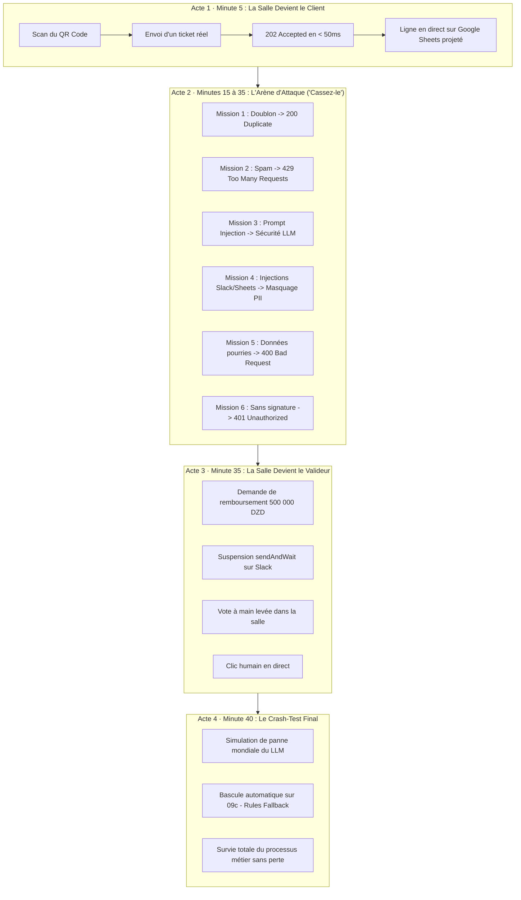

# 🇩🇿 Algeria 2.0 | Masterclass n8n Production
## « Essayez de casser mon workflow » — Industrialisation de Processus Métier avec n8n, Webhooks & APIs

[](https://mustrain.app.n8n.cloud)
[](https://en.wikipedia.org/wiki/HMAC)
[](https://nimble-cyclone-suwml6q.vercel.app)
[](https://slack.com)
[](https://algeria20.com)

---

## 🌟 Le Concept de l'Atelier : « Essayez de casser mon workflow »

Ce dépôt contient l'infrastructure complète de l'atelier interactif présenté à **Algeria 2.0**.
Plutôt qu'une présentation théorique passive, **la salle entière joue le rôle du client et tente d'attaquer en direct le workflow d'entreprise déployé sur n8n Cloud**. Chaque attaque qui échoue devant l'assistance prouve l'un des piliers essentiels de mise en production.

* 🌐 **Portail Web Public (Interactif) :** [https://nimble-cyclone-suwml6q.vercel.app](https://nimble-cyclone-suwml6q.vercel.app)
* 📷 **QR Code à projeter dans la salle :** [`assets/qr-vercel.png`](file:///c:/Users/must_/OneDrive/Bureau/N8n-Workshop/assets/qr-vercel.png)
* ⚡ **Workflow n8n de Production (36 nœuds) :** [`workflows/production/workshop-demandes-clients-production-v-finale.json`](file:///c:/Users/must_/OneDrive/Bureau/N8n-Workshop/workflows/production/workshop-demandes-clients-production-v-finale.json)

---

## 📁 Architecture Hiérarchisée du Répertoire

Le projet est organisé selon les standards professionnels d'un monorepo prêt pour la production :

```
N8n-Workshop/
├── 📁 workflows/                 # Workflows n8n exportés en JSON (prêts à importer)
│   ├── production/              # Le workflow d'entreprise final (36 nœuds)
│   │   ├── workshop-demandes-clients-production-v-finale.json
│   │   └── train-test-corrected.json
│   ├── modules/                 # Sous-workflows modulaires (Error handler, Lead intake)
│   │   ├── n8n-error-handler-workflow.json
│   │   ├── n8n-lead-intake-workflow.json
│   │   └── n8n-lead-pipeline-cloud.json
│   └── templates/               # Workflows starter distribués aux participants
│       ├── 01_main_lead_pipeline.json
│       └── 02_error_handler.json
│
├── 📁 portal/                    # Application Web interactive (React 18, Vite 5, Tailwind, React Bits)
│   ├── src/                     # Code source frontend (Hero, Arène, Slack, Fallback, Checklist)
│   │   ├── components/reactbits/# Suite d'animations React Bits (SplitText, SpotlightCard, etc.)
│   │   ├── utils/               # Logique d'attaque, cryptographie SubtleCrypto HMAC & API
│   │   └── App.jsx              # Orchestrateur de l'application
│   ├── public/                  # Assets statiques publics
│   ├── dist/                    # Bundle de production compilé
│   └── vercel.json              # Configuration de déploiement SPA Vercel
│
├── 📁 presentation/              # Support de présentation moderne (Slidev)
│   ├── slides.md                # 35+ slides interactives en Markdown, Vue & Shiki
│   └── package.json             # Dépendances Slidev
│
├── 📁 docs/                      # Documentation technique complète & Guides orateur
│   ├── WORKSHOP_SPEAKER_GUIDE.md# Guide minute par minute pour l'orateur (Playbook)
│   ├── CHECKLIST-production-ready.md # La checklist des 12 piliers d'industrialisation
│   ├── PLAN-construction-workflow-n8n-cloud.md # Architecture détaillée des 36 nœuds
│   └── README_SETUP.md          # Guide de démarrage pas à pas
│
├── 📁 scripts/                   # Outillage de test, validation et déploiement
│   ├── deploy-vercel.bat        # Déploiement automatique vers Vercel en 1 clic
│   ├── start-portal.bat         # Lancement du portail en local (http://localhost:3000)
│   ├── start-portal-public.bat  # Lancement avec tunnel public sécurisé Cloudflare
│   ├── test_workshop_verification.cjs # Suite de vérification bout-en-bout automatisée
│   ├── test_system.cjs          # Script de test Node.js
│   ├── test-customer-support.ps1# Batterie de tests PowerShell (HMAC + Scénarios)
│   └── generate_qr_vercel.cjs   # Script de génération du QR code Vercel
│
├── 📁 assets/                    # Médias, images et QR codes haute résolution
│   ├── qr-phone.png             # QR code pour smartphone
│   └── qr-vercel.png            # QR code vers l'URL Vercel publique
│
├── start-portal.bat              # Raccourci rapide racine : Lancer le portail
├── deploy-vercel.bat             # Raccourci rapide racine : Déployer sur Vercel
└── README.md                     # Hub de documentation centrale
```

---

## ⏱️ Déroulé de l'Atelier en 4 Actes



---

## 🚀 Démarrage Rapide

### 1. Lancer le Portail Interactif (Local)
Double-cliquez sur `start-portal.bat` ou exécutez :
```powershell
cd portal
npm run dev
```
Accédez à `http://localhost:3000`.

### 2. Déployer sur Vercel
Double-cliquez sur `deploy-vercel.bat` ou exécutez :
```powershell
cd portal
npm run build
npx vercel deploy dist --yes
```

### 3. Lancer la Présentation Slidev
```powershell
cd presentation
npm run dev
```
Accédez à `http://localhost:3030` pour les slides et `http://localhost:3030/presenter` pour la vue présentateur avec notes.

### 4. Lancer la Vérification Technique Automatisée
```powershell
node scripts/test_workshop_verification.cjs
```

---

## 🏆 Checklist des 12 Piliers d'Industrialisation

| # | Pilier | Implémentation dans le Workflow n8n |
|---|---|---|
| **1** | **Ingestion Sécurisée** | Signature cryptographique `HMAC-SHA256` sur corps brut (`rawBody`) avec timing safe check. Rejet `401`. |
| **2** | **Validation aux Frontières** | Nœud `IF` validant email, nom et catégorie avant tout appel d'API. Rejet `400`. |
| **3** | **Asynchronisme Immédiat** | Réponse `202 Accepted` en `< 50ms` libérant le client sans attendre les traitements lourds. |
| **4** | **Idempotence & Anti-Rejeu** | Déduplication par clé de hachage et mémoire statique 24h. Acquittement `200 Duplicate`. |
| **5** | **Nettoyage PII & Anti-XSS** | Regex assainissant `[EMAIL]`, `[PHONE]`, et neutralisant `<!channel>` ou formules `=HYPERLINK`. |
| **6** | **IA Contrôlée & Structurée** | Schéma JSON strict, enums fermés, température basse et consigne de prompt défensive anti-injection. |
| **7** | **Filet de Secours Déterministe** | `09c - Rules Fallback` : règles par mots-clés FR/AR si le fournisseur LLM est indisponible. |
| **8** | **Human-in-the-Loop** | Nœud Slack `sendAndWait` pour les décisions financières ou litiges sensibles. |
| **9** | **Résilience Réseau** | Retries automatiques exponentiels (3x) sur les requêtes HTTP externes. |
| **10** | **Rate Limiting & Anti-DDoS** | Fenêtre glissante limitant les requêtes abusives (`429 Too Many Requests`). |
| **11** | **Traçabilité & Corrélation** | Génération systématique d'un Correlation ID `SUP-{{ $execution.id }}` reporté dans les logs et Google Sheets. |
| **12** | **Gestion Centralisée des Erreurs** | Sous-workflow d'erreur dédié interceptant tout échec avec alerte d'urgence. |

---

## 📄 Documentation de Référence

* 📖 **[Guide de l'Orateur (Playbook)](docs/WORKSHOP_SPEAKER_GUIDE.md)**
* 📋 **[Checklist Complète des 12 Piliers (.MD)](docs/CHECKLIST-production-ready.md)**
* 🏗️ **[Plan de Construction n8n Cloud](docs/PLAN-construction-workflow-n8n-cloud.md)**
* ⚙️ **[Guide d'Installation et Configuration](docs/README_SETUP.md)**
