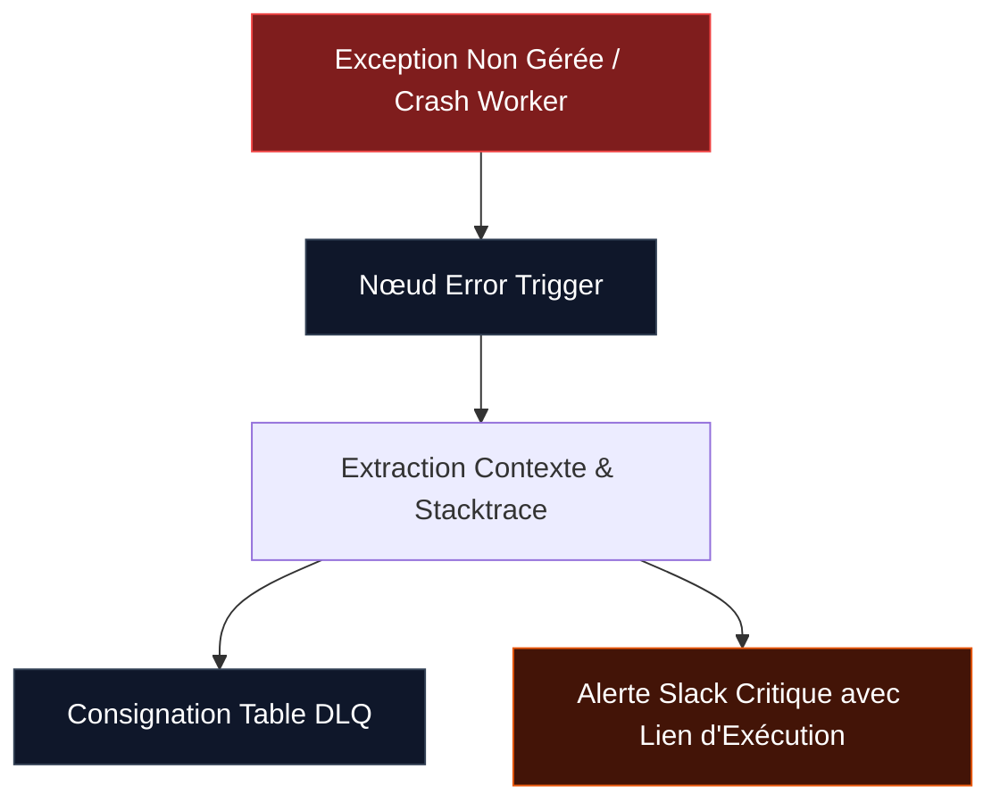

<div class="flex flex-col items-center justify-center h-full px-8 text-center">
  <div class="flex items-center gap-3 mb-6">
    <span class="px-3 py-1 rounded-full text-xs font-mono uppercase tracking-widest font-semibold bg-rose-500/10 text-rose-400 border border-rose-500/20">
      Algeria 2.0
    </span>
    <span class="px-3 py-1 rounded-full text-xs font-mono uppercase tracking-widest font-semibold bg-slate-800 text-slate-300 border border-slate-700">
      Session Technique Avancée
    </span>
    <span class="px-3 py-1 rounded-full text-xs font-mono uppercase tracking-widest font-semibold bg-emerald-500/10 text-emerald-400 border border-emerald-500/20">
      Production-Ready
    </span>
  </div>

  <h1 class="text-4xl md:text-5xl font-extrabold tracking-tight text-white mb-4 leading-tight">
    Industrialiser un Processus Métier<br/>
    <span class="bg-gradient-to-r from-rose-500 via-pink-400 to-amber-300 bg-clip-text text-transparent">
      avec n8n, Webhooks & APIs
    </span>
  </h1>

  <p class="text-lg text-slate-400 max-w-2xl font-light leading-relaxed mb-8">
    De l'ingestion cryptographique Zero-Trust à la supervision humaine interactive : concevoir des architectures automatisées résilientes pour l'entreprise.
  </p>

  <div class="grid grid-cols-4 gap-4 w-full max-w-3xl pt-6 border-t border-slate-800/80 text-left">
    <div class="p-3 rounded-lg bg-slate-900/60 border border-slate-800">
      <div class="text-xs font-mono text-slate-500 uppercase tracking-wider">Sécurité</div>
      <div class="text-sm font-semibold text-slate-200 mt-0.5">HMAC-SHA256</div>
    </div>
    <div class="p-3 rounded-lg bg-slate-900/60 border border-slate-800">
      <div class="text-xs font-mono text-slate-500 uppercase tracking-wider">Latence</div>
      <div class="text-sm font-semibold text-slate-200 mt-0.5">&lt; 50ms (202 Async)</div>
    </div>
    <div class="p-3 rounded-lg bg-slate-900/60 border border-slate-800">
      <div class="text-xs font-mono text-slate-500 uppercase tracking-wider">Gouvernance IA</div>
      <div class="text-sm font-semibold text-slate-200 mt-0.5">JSON Strict + Fallback</div>
    </div>
    <div class="p-3 rounded-lg bg-slate-900/60 border border-slate-800">
      <div class="text-xs font-mono text-slate-500 uppercase tracking-wider">Contrôle</div>
      <div class="text-sm font-semibold text-slate-200 mt-0.5">Human-in-the-Loop</div>
    </div>
  </div>
</div>

<!--
Introduction au workshop Algeria 2.0.
Objectif : montrer comment passer d'un bricolage ou prototype n8n à une véritable solution d'entreprise fiable et sécurisée.
-->

---
layout: default
---

# La Problématique : La Dette Technique en Automatisation

<p class="text-slate-400 text-sm -mt-2 mb-6">Pourquoi la majorité des intégrations n8n échouent lors du passage à l'échelle.</p>

<div class="grid grid-cols-3 gap-5">
  <div v-click class="p-5 rounded-xl bg-slate-900/80 border border-red-500/20 shadow-lg hover:border-red-500/40 transition">
    <div class="flex items-center justify-between mb-3">
      <span class="text-xs font-mono uppercase tracking-wider px-2 py-0.5 rounded bg-red-500/10 text-red-400 border border-red-500/20">Vulnérabilité</span>
      <span class="text-xs font-mono text-slate-500">01</span>
    </div>
    <h3 class="text-base font-bold text-white mb-2">Ingestion Non Sécurisée</h3>
    <p class="text-xs text-slate-400 leading-relaxed">
      Utilisation d'URLs de webhooks publiques ou de simples clés statiques exposées. Vulnérable au rejeu, à l'injection de données altérées et au spoofing d'identité.
    </p>
    <div class="mt-4 pt-3 border-t border-slate-800 text-[11px] font-mono text-red-400">
      Risque : Corruption de la base CRM
    </div>
  </div>

  <div v-click class="p-5 rounded-xl bg-slate-900/80 border border-amber-500/20 shadow-lg hover:border-amber-500/40 transition">
    <div class="flex items-center justify-between mb-3">
      <span class="text-xs font-mono uppercase tracking-wider px-2 py-0.5 rounded bg-amber-500/10 text-amber-400 border border-amber-500/20">Latence & Blocage</span>
      <span class="text-xs font-mono text-slate-500">02</span>
    </div>
    <h3 class="text-base font-bold text-white mb-2">Traitement Synchrone Inadapté</h3>
    <p class="text-xs text-slate-400 leading-relaxed">
      Forcer l'appelant HTTP à attendre la complétion d'un modèle LLM (3 à 15 secondes). Provoque des timeouts réseau (504 Gateway), des réessais sauvages et des doublons.
    </p>
    <div class="mt-4 pt-3 border-t border-slate-800 text-[11px] font-mono text-amber-400">
      Risque : Écroulement de charge
    </div>
  </div>

  <div v-click class="p-5 rounded-xl bg-slate-900/80 border border-rose-500/20 shadow-lg hover:border-rose-500/40 transition">
    <div class="flex items-center justify-between mb-3">
      <span class="text-xs font-mono uppercase tracking-wider px-2 py-0.5 rounded bg-rose-500/10 text-rose-400 border border-rose-500/20">Non-Déterminisme</span>
      <span class="text-xs font-mono text-slate-500">03</span>
    </div>
    <h3 class="text-base font-bold text-white mb-2">Boîte Noire IA sans Filet</h3>
    <p class="text-xs text-slate-400 leading-relaxed">
      Faire confiance aveuglément à un modèle de langage sans validation de schéma JSON, sans masquage PII, et sans circuit déterministe en cas de quota épuisé (429).
    </p>
    <div class="mt-4 pt-3 border-t border-slate-800 text-[11px] font-mono text-rose-400">
      Risque : Perte de données & non-conformité
    </div>
  </div>
</div>

<div v-click class="mt-8 p-4 rounded-xl bg-gradient-to-r from-slate-900 to-slate-950 border border-slate-800 flex items-center justify-between">
  <div>
    <div class="text-xs font-mono text-rose-400 uppercase tracking-wider">Objectif de la Session</div>
    <div class="text-sm font-semibold text-white mt-0.5">Implémenter les 5 piliers de l'architecture d'entreprise n8n.</div>
  </div>
  <div class="text-xs font-mono text-slate-400">Standard de Résilience Niveau 3</div>
</div>

<!--
Voici le constat terrain. En production, les webhooks subissent des pannes d'APIs tierces, des variations de latence LLM et des payloads malformés.
-->

---
layout: default
---

# Architecture Globale du Processus Métier

```mermaid
graph LR
    subgraph S1["1. SÉCURITÉ ZERO-TRUST"]
      A["Appelant HTTP"] -->|POST brut| B["Webhook Raw Body"]
      B --> C{"Vérification HMAC"}
      C -->|Invalide| D["401 Unauthorized"]
      C -->|Valide| E{"Validation Schéma"}
      E -->|Invalide| F["400 Bad Request"]
    end

    subgraph S2["2. ASYNCHRONICITÉ & IDEMPOTENCE"]
      E -->|Valide| G["Déduplication 24h"]
      G -->|Doublon| H["200 OK Duplicate"]
      G -->|Unique| I["202 Accepted &lt;50ms"]
    end

    subgraph S3["3. TRAITEMENT DE FOND"]
      I --> J["Enrichissement API"]
      J --> K["Anonymisation PII"]
      K --> L["Analyse LLM Structurée"]
      L -.->|Échec / 429| M["Rules Fallback Déterministe"]
      L --> N["Business Rules Gate"]
      M --> N
    end

    subgraph S4["4. SUPERVISION & AUDIT"]
      N -->|Critique / Doute| O["Slack sendAndWait (HITL)"]
      N -->|Standard| P["Auto-Approved"]
      O --> Q["Audit Google Sheets"]
      P --> Q
      Q --> R["Execution Logs"]
    end

    style S1 fill:#0f172a,stroke:#334155,stroke-width:1px
    style S2 fill:#0f172a,stroke:#334155,stroke-width:1px
    style S3 fill:#0f172a,stroke:#334155,stroke-width:1px
    style S4 fill:#0f172a,stroke:#334155,stroke-width:1px
    style D fill:#7f1d1d,stroke:#ef4444,color:#fff
    style F fill:#7f1d1d,stroke:#ef4444,color:#fff
    style I fill:#0369a1,stroke:#0284c7,color:#fff
    style O fill:#431407,stroke:#ea580c,color:#fff
    style Q fill:#064e3b,stroke:#059669,color:#fff
```

<p class="text-slate-400 text-sm -mt-2 mb-4">Pipeline complet : Ingestion, validation, enrichissement, inférence IA, arbitrage et audit.</p>



<!--
Voici l'architecture que nous allons détailler bloc par bloc. Notez la séparation nette entre le circuit réseau synchrone (S1/S2) et le circuit métier asynchrone (S3/S4).
-->

---
layout: default
---

# Pilier 1 : Ingestion Cryptographique HMAC-SHA256

<p class="text-slate-400 text-sm -mt-2 mb-4">Garantir l'authenticité de l'émetteur et l'intégrité intégrale du payload en transit.</p>

<div class="grid grid-cols-2 gap-6">
  <div>
    <div class="text-xs font-mono uppercase tracking-wider text-rose-400 mb-2">Mécanisme Cryptographique</div>
    <div class="p-4 rounded-xl bg-slate-900 border border-slate-800 text-xs text-slate-300 space-y-3 leading-relaxed">
      <div>
        <span class="font-bold text-white">1. Capture Octets Bruts :</span> Le webhook est configuré avec <code>rawBody: true</code>. Toute normalisation JSON préalable corrompt le calcul du hash.
      </div>
      <div>
        <span class="font-bold text-white">2. Calcul du Digest :</span> Génération de l'empreinte cryptographique avec la clé secrète partagée :
        <div class="font-mono text-[11px] bg-slate-950 p-2 rounded mt-1 text-slate-300 border border-slate-800">
          HMAC = SHA256(raw_bytes, shared_secret)
        </div>
      </div>
      <div>
        <span class="font-bold text-white">3. Résistance aux Timing Attacks :</span> Comparaison octet par octet en temps constant pour empêcher l'analyse statistique de la latence de réponse.
      </div>
    </div>

    <div v-click class="mt-4 p-3 rounded-lg bg-red-500/10 border border-red-500/30 flex items-center justify-between">
      <span class="text-xs font-semibold text-red-300">Absence ou falsification de signature</span>
      <span class="text-xs font-mono font-bold px-2 py-0.5 rounded bg-red-500/20 text-red-400">401 Unauthorized</span>
    </div>
  </div>

  <div>
    <div class="text-xs font-mono uppercase tracking-wider text-slate-400 mb-2">Implémentation n8n (Nœud Code)</div>

```javascript {all|1-4|6-13|15-18}
// Récupération des signatures
const receivedSig = $input.item.json.headers['x-signature'] || '';
const computedSig = $input.item.json.computedHmac;

// Comparaison en temps constant (Timing-Safe XOR)
const a = Buffer.from(receivedSig, 'hex');
const b = Buffer.from(computedSig, 'hex');

let diff = a.length !== b.length ? 1 : 0;
const length = Math.max(a.length, b.length);
for (let i = 0; i < length; i++) {
  diff |= (a[i] || 0) ^ (b[i] || 0);
}

// Rejet immédiat si signature altérée
if (diff !== 0) {
  return [{ json: { authorized: false, status: 401 } }];
}
return [{ json: { authorized: true, status: 200 } }];
```

  </div>
</div>

<!--
Le point technique clé ici : l'utilisation d'une comparaison timing-safe. Une simple comparaison avec === fuitait des informations temporelles permettant de forger une signature.
-->

---
layout: default
---

# Pilier 2 : Découplage Asynchrone & Idempotence

<p class="text-slate-400 text-sm -mt-2 mb-4">Protéger l'appelant des latences LLM tout en neutralisant les réémissions réseau accidentelles.</p>

<div class="grid grid-cols-2 gap-6">
  <div v-click>
    <div class="p-5 rounded-xl bg-slate-900 border border-slate-800">
      <div class="flex items-center justify-between mb-3">
        <span class="text-xs font-mono uppercase tracking-wider text-sky-400 font-semibold">Performance Réseau</span>
        <span class="text-xs font-mono px-2 py-0.5 rounded bg-sky-500/10 text-sky-400 border border-sky-500/20">&lt; 50 ms</span>
      </div>
      <h3 class="text-base font-bold text-white mb-2">Réponse Asynchrone HTTP 202</h3>
      <p class="text-xs text-slate-400 leading-relaxed mb-3">
        Dès que la signature cryptographique et la conformité des données sont vérifiées, n8n émet un <code>202 Accepted</code> immédiat.
      </p>
      <div class="p-3 rounded bg-slate-950 font-mono text-[11px] text-slate-300 border border-slate-800">
        <div>HTTP/1.1 202 Accepted</div>
        <div>Content-Type: application/json</div>
        <div class="text-sky-400 mt-1">{"ticket_id":"SUP-20261112-1430","status":"queued"}</div>
      </div>
      <p class="text-[11px] text-slate-500 mt-2">
        L'appelant est libéré instantanément. L'orchestration lourde (APIs, IA) continue en background.
      </p>
    </div>
  </div>

  <div v-click>
    <div class="p-5 rounded-xl bg-slate-900 border border-slate-800">
      <div class="flex items-center justify-between mb-3">
        <span class="text-xs font-mono uppercase tracking-wider text-emerald-400 font-semibold">Idempotence 24h</span>
        <span class="text-xs font-mono px-2 py-0.5 rounded bg-emerald-500/10 text-emerald-400 border border-emerald-500/20">Anti-Doublon</span>
      </div>
      <h3 class="text-base font-bold text-white mb-2">Mémoire Tournante d'Empreinte</h3>
      <p class="text-xs text-slate-400 leading-relaxed mb-3">
        Génération d'un hash unique combinant l'email et le payload. Mémorisation avec expiration glissante de 24 heures.
      </p>
      <div class="p-3 rounded bg-slate-950 font-mono text-[11px] text-slate-300 border border-slate-800">
        <div>HTTP/1.1 200 OK</div>
        <div>Content-Type: application/json</div>
        <div class="text-emerald-400 mt-1">{"duplicate": true, "acknowledged": true}</div>
      </div>
      <p class="text-[11px] text-slate-500 mt-2">
        En cas de retry de l'appelant, la requête est acquittée sans déclencher une seconde exécution IA.
      </p>
    </div>
  </div>
</div>

<!--
Cette architecture résout 100% des problèmes de timeout lors de pics de trafic. L'API d'ingestion répond en moins de 50ms, quelle que soit la charge des modèles d'IA en aval.
-->

---
layout: default
---

# Pilier 3 : Résilience d'Intégration & Confidentialité PII

<p class="text-slate-400 text-sm -mt-2 mb-4">Gérer l'indisponibilité des services tiers et garantir la stricte conformité réglementaire.</p>

<div class="grid grid-cols-2 gap-6">
  <div>
    <div class="text-xs font-mono uppercase tracking-wider text-slate-400 mb-2">Stratégie de Tolérance aux Pannes API</div>
    
    <div class="p-4 rounded-xl bg-slate-900 border border-slate-800 space-y-3">
      <div class="flex items-start gap-3">
        <div class="w-6 h-6 rounded bg-slate-800 text-slate-300 flex items-center justify-center font-mono text-xs shrink-0 mt-0.5">1</div>
        <div>
          <div class="text-xs font-bold text-white">Retry Automatique avec Backoff</div>
          <div class="text-[11px] text-slate-400">3 tentatives consécutives avec délai d'attente progressif (1s, 2s, 4s).</div>
        </div>
      </div>

      <div class="flex items-start gap-3">
        <div class="w-6 h-6 rounded bg-slate-800 text-slate-300 flex items-center justify-center font-mono text-xs shrink-0 mt-0.5">2</div>
        <div>
          <div class="text-xs font-bold text-white">Non-Blocage du Pipeline Principal</div>
          <div class="text-[11px] text-slate-400">Activation de <code>onError: continueRegularOutput</code>. L'indisponibilité du catalogue produit n'arrête pas le traitement du ticket.</div>
        </div>
      </div>

      <div class="flex items-start gap-3">
        <div class="w-6 h-6 rounded bg-slate-800 text-slate-300 flex items-center justify-center font-mono text-xs shrink-0 mt-0.5">3</div>
        <div>
          <div class="text-xs font-bold text-white">Marquage de Dégradation</div>
          <div class="text-[11px] text-slate-400">Le ticket est étiqueté <code>enrichment_failed: true</code> pour inspection ultérieure.</div>
        </div>
      </div>
    </div>
  </div>

  <div>
    <div class="text-xs font-mono uppercase tracking-wider text-slate-400 mb-2">Masquage PII Systématique (RGPD)</div>

    <div class="p-4 rounded-xl bg-slate-900 border border-slate-800">
      <div class="text-[11px] font-mono text-red-400 mb-1">Entrée Brute (Contient des Données Personnelles) :</div>
      <div class="p-2.5 rounded bg-slate-950 font-mono text-[11px] text-slate-300 border border-slate-800 mb-3">
        "Bonjour, je suis Ali Dahmani (<span class="text-red-400 font-semibold">ali.dahmani@gmail.com</span>, tél: <span class="text-red-400 font-semibold">+213 550 12 34 56</span>). Mon routeur est en panne..."
      </div>

      <div class="text-[11px] font-mono text-emerald-400 mb-1">Payload Anonymisé Transmis au LLM :</div>
      <div class="p-2.5 rounded bg-slate-950 font-mono text-[11px] text-slate-300 border border-slate-800">
        "Bonjour, je suis [NOM] (<span class="text-emerald-400 font-semibold">[EMAIL]</span>, tél: <span class="text-emerald-400 font-semibold">[PHONE]</span>). Mon routeur est en panne..."
      </div>

      <div class="mt-3 text-[11px] text-slate-500 leading-relaxed">
        Aucune coordonnée directe ne transite vers les infrastructures de modèles externes. La réconciliation finale est assurée localement par l'identifiant de corrélation.
      </div>
    </div>
  </div>
</div>

<!--
Principe de minimisation et de confidentialité : le LLM a besoin de comprendre l'intention et le sentiment du client, il n'a aucunement besoin de son adresse email réelle ni de son numéro de téléphone.
-->

---
layout: default
---

# Pilier 4 : IA Encadrée & Secours Déterministe

<p class="text-slate-400 text-sm -mt-2 mb-4">Structured Outputs, contrainte de schéma JSON et disjoncteur sans IA.</p>

<div class="grid grid-cols-2 gap-6">
  <div>
    <div class="text-xs font-mono uppercase tracking-wider text-purple-400 mb-2">Contrat de Sortie Inviolable (LangChain Parser)</div>

```json
{
  "type": "object",
  "properties": {
    "intent": {
      "type": "string",
      "enum": ["technical_issue", "billing", "refund", "inquiry"]
    },
    "priority": {
      "type": "string",
      "enum": ["low", "medium", "high", "urgent"]
    },
    "confidence": {
      "type": "number",
      "minimum": 0,
      "maximum": 1
    },
    "summary": { "type": "string", "maxLength": 160 }
  },
  "required": ["intent", "priority", "confidence"]
}
```

    <div class="mt-2 text-[11px] text-slate-400">
      Élimine 100% des hallucinations de formatage et protège contre les réponses en texte libre.
    </div>
  </div>

  <div>
    <div class="text-xs font-mono uppercase tracking-wider text-amber-400 mb-2">Circuit de Secours Déterministe (Zero-AI Fallback)</div>

    <div class="p-4 rounded-xl bg-slate-900 border border-slate-800">
      <div class="text-xs font-bold text-white mb-2">Quand l'IA est Indisponible (429, 503, Timeout) :</div>
      <p class="text-[11px] text-slate-400 leading-relaxed mb-3">
        Bascule instantanée sur un moteur d'inférence par règles linguistiques déterministes (Français, Arabe, Anglais) :
      </p>

      <div class="p-2.5 rounded bg-slate-950 font-mono text-[10px] text-slate-300 border border-slate-800 space-y-1">
        <div><span class="text-amber-400 font-semibold">URGENT</span> : ['urgent', 'عاجل', 'bloquant', 'emergency', 'panne']</div>
        <div><span class="text-sky-400 font-semibold">BILLING</span> : ['facture', 'فاتورة', 'paiement', 'remboursement']</div>
        <div><span class="text-slate-400 font-semibold">FALLBACK_FLAG</span> : <span class="text-emerald-400">fallback_used = true</span></div>
      </div>

      <div class="mt-3 p-2 rounded bg-amber-500/10 border border-amber-500/20 text-[11px] text-amber-300">
        Garantit la continuité du service même lors d'une coupure totale d'OpenRouter ou d'OpenAI.
      </div>
    </div>
  </div>
</div>

<!--
L'IA apporte de la flexibilité sémantique, mais le fallback déterministe apporte la garantie de continuité opérationnelle. L'entreprise ne s'arrête jamais de fonctionner.
-->

---
layout: default
---

# Pilier 5 : Supervision Humaine (Human-in-the-Loop)

<p class="text-slate-400 text-sm -mt-2 mb-4">L'algorithme analyse, mais l'humain conserve le pouvoir de décision sur les cas sensibles.</p>

<div class="grid grid-cols-5 gap-6">
  <div class="col-span-2 space-y-3">
    <div class="text-xs font-mono uppercase tracking-wider text-slate-400">Critères d'Escalade Interactive</div>

    <div class="p-3 rounded-lg bg-slate-900 border border-slate-800">
      <div class="text-xs font-bold text-rose-400">1. Priorité Critique</div>
      <div class="text-[11px] text-slate-400 mt-0.5"><code>priority === 'urgent'</code> ou risque de churn.</div>
    </div>

    <div class="p-3 rounded-lg bg-slate-900 border border-slate-800">
      <div class="text-xs font-bold text-amber-400">2. Doute Statistique IA</div>
      <div class="text-[11px] text-slate-400 mt-0.5"><code>confidence &lt; 0.70</code> (arbitrage incertain).</div>
    </div>

    <div class="p-3 rounded-lg bg-slate-900 border border-slate-800">
      <div class="text-xs font-bold text-sky-400">3. Déclenchement du Fallback</div>
      <div class="text-[11px] text-slate-400 mt-0.5">Le moteur de règles sans IA a été sollicité.</div>
    </div>

    <div class="p-3 rounded-lg bg-slate-900 border border-slate-800">
      <div class="text-xs font-bold text-purple-400">4. Impact Financier</div>
      <div class="text-[11px] text-slate-400 mt-0.5">Demande de remboursement ou litige contractuel.</div>
    </div>
  </div>

  <div class="col-span-3">
    <div class="text-xs font-mono uppercase tracking-wider text-slate-400 mb-2">Interface Opérateur Slack (Mécanisme sendAndWait)</div>

    <div class="p-5 rounded-xl bg-slate-900 border border-slate-700/80 shadow-2xl">
      <div class="flex items-center justify-between pb-3 border-b border-slate-800 mb-4">
        <div class="flex items-center gap-2">
          <div class="w-3 h-3 rounded-full bg-rose-500"></div>
          <span class="text-xs font-mono font-bold text-white">#leads-escalation</span>
        </div>
        <span class="text-[11px] font-mono text-slate-500">n8n Execution Bot</span>
      </div>

      <div class="space-y-2 text-xs">
        <div class="text-slate-300 font-semibold">Ticket SUP-20261112-9842 nécessite votre validation</div>
        <div class="p-3 rounded bg-slate-950 border border-slate-800 font-mono text-[11px] space-y-1 text-slate-300">
          <div><span class="text-slate-500">Client :</span> Entreprise Sonatrach Partner</div>
          <div><span class="text-slate-500">Intention :</span> Demande de remboursement prioritaire</div>
          <div><span class="text-slate-500">Confiance IA :</span> <span class="text-amber-400 font-bold">64% (Seuil requis: 70%)</span></div>
          <div><span class="text-slate-500">Action recommandée :</span> Validation responsable de compte</div>
        </div>

        <div class="pt-3 flex gap-3">
          <button class="flex-1 py-2 px-3 rounded bg-emerald-600 hover:bg-emerald-500 text-white font-semibold text-xs transition">
            Confirmer & Traiter
          </button>
          <button class="flex-1 py-2 px-3 rounded bg-red-600 hover:bg-red-500 text-white font-semibold text-xs transition">
            Rejeter la Demande
          </button>
        </div>

        <div class="text-center text-[10px] font-mono text-slate-500 pt-2">
          Workflow en suspension automatique. Reprise d'exécution dès le clic opérateur.
        </div>
      </div>
    </div>
  </div>
</div>

<!--
Le nœud Slack sendAndWait est l'une des fonctionnalités les plus puissantes de n8n : il met le thread d'exécution en veille sans consommer de CPU, et reprend exactement là où il s'est arrêté dès l'interaction de l'utilisateur.
-->

---
layout: default
---

# Observabilité, Audit & Dead Letter Queue (DLQ)

<p class="text-slate-400 text-sm -mt-2 mb-4">Ne jamais perdre un événement métier, même lors d'une défaillance infrastructure majeure.</p>

<div class="grid grid-cols-2 gap-6">
  <div>
    <div class="text-xs font-mono uppercase tracking-wider text-slate-400 mb-2">Double Journalisation Spécialisée</div>

    <div class="space-y-3">
      <div class="p-4 rounded-xl bg-slate-900 border border-slate-800">
        <div class="text-xs font-bold text-emerald-400 mb-1">1. Table d'Audit Métier (Support Tickets)</div>
        <p class="text-[11px] text-slate-400 leading-relaxed">
          Destinée aux équipes de support et de direction : enregistre chaque demande, l'intention classifiée, le statut d'approbation et l'historique de décision.
        </p>
        <div class="mt-2 text-[10px] font-mono text-slate-500">
          Champs : ticket_id, customer_name, intent, priority, approval_status, confidence
        </div>
      </div>

      <div class="p-4 rounded-xl bg-slate-900 border border-slate-800">
        <div class="text-xs font-bold text-sky-400 mb-1">2. Table Technique (Execution Logs)</div>
        <p class="text-[11px] text-slate-400 leading-relaxed">
          Destinée à l'équipe DevOps / Automatisation : trace les temps d'exécution par phase, les identifiants d'exécution n8n et les codes de statut HTTP.
        </p>
        <div class="mt-2 text-[10px] font-mono text-slate-500">
          Champs : execution_id, correlation_id, event, duration_ms, node_name, status
        </div>
      </div>
    </div>
  </div>

  <div>
    <div class="text-xs font-mono uppercase tracking-wider text-rose-400 mb-2">Architecture Dead Letter Queue (DLQ)</div>

    <div class="p-4 rounded-xl bg-slate-900 border border-slate-800">
      <div class="text-xs font-bold text-white mb-2">Interception Globale des Crashes Système</div>
      <p class="text-[11px] text-slate-400 leading-relaxed mb-3">
        Relié via <code>Settings &gt; Error Workflow</code> du workflow principal :
      </p>



      <div class="mt-3 text-[11px] text-slate-400">
        Permet à l'ingénieur de cliquer directement sur le lien de l'exécution en erreur pour rejouer le payload après correction.
      </div>
    </div>
  </div>
</div>

<!--
Zéro perte de données. Même si une coupure réseau ou un crash de worker intervient, la DLQ enregistre le payload d'origine et alerte l'équipe avec le lien direct d'inspection.
-->

---
layout: default
---

# Démonstration Live : Matrice de Validation

<p class="text-slate-400 text-sm -mt-2 mb-4">Exécution de la batterie de tests automatisée via le banc d'essai PowerShell.</p>

<div class="grid grid-cols-2 gap-6">
  <div>
    <div class="text-xs font-mono uppercase tracking-wider text-slate-400 mb-2">Commande de Banc d'Essai</div>

```powershell {all|2-3|5-6|8-10}
# Test 1 : Rejet sans signature
.\test-customer-support.ps1
# Résultat : 401 Unauthorized (< 15ms)

# Test 2 : Rejet sur altération payload
.\test-customer-support.ps1 -Tamper
# Résultat : 401 Unauthorized (Digest mismatch)

# Test 3 : Traitement complet nominal
.\test-customer-support.ps1 -Secret "PvZsTUNGI7vHRdjK"
# Résultat : 202 Accepted (< 45ms)
# -> Déduplication OK
# -> Masquage PII exécuté
# -> LLM JSON Schema validé
# -> Enregistrement audit effectué
```

  </div>

  <div>
    <div class="text-xs font-mono uppercase tracking-wider text-slate-400 mb-2">Comportements Vérifiés en Direct</div>

    <div class="space-y-2.5">
      <div class="p-3 rounded-lg bg-slate-900 border border-slate-800 flex items-center justify-between text-xs">
        <span class="text-slate-300">Intrusion sans clé de signature</span>
        <span class="font-mono font-bold text-red-400 bg-red-500/10 px-2 py-0.5 rounded border border-red-500/20">401 REJET</span>
      </div>

      <div class="p-3 rounded-lg bg-slate-900 border border-slate-800 flex items-center justify-between text-xs">
        <span class="text-slate-300">Format email ou nom manquant</span>
        <span class="font-mono font-bold text-amber-400 bg-amber-500/10 px-2 py-0.5 rounded border border-amber-500/20">400 REJET</span>
      </div>

      <div class="p-3 rounded-lg bg-slate-900 border border-slate-800 flex items-center justify-between text-xs">
        <span class="text-slate-300">Requête conforme et authentifiée</span>
        <span class="font-mono font-bold text-sky-400 bg-sky-500/10 px-2 py-0.5 rounded border border-sky-500/20">202 ACCEPTED</span>
      </div>

      <div class="p-3 rounded-lg bg-slate-900 border border-slate-800 flex items-center justify-between text-xs">
        <span class="text-slate-300">Rejeu immédiat d'un même ticket</span>
        <span class="font-mono font-bold text-emerald-400 bg-emerald-500/10 px-2 py-0.5 rounded border border-emerald-500/20">200 DUPLICATE</span>
      </div>

      <div class="p-3 rounded-lg bg-slate-900 border border-slate-800 flex items-center justify-between text-xs">
        <span class="text-slate-300">Simulation coupure API LLM</span>
        <span class="font-mono font-bold text-purple-400 bg-purple-500/10 px-2 py-0.5 rounded border border-purple-500/20">FALLBACK TRI-LANG</span>
      </div>
    </div>
  </div>
</div>

<!--
Démonstration en temps réel : nous allons lancer le script PowerShell et vérifier sur l'interface n8n Cloud que chaque branche d'exécution réagit conformément aux spécifications.
-->

---
layout: default
---

# Grille de Maturité : Les 12 Piliers de Production

<p class="text-slate-400 text-sm -mt-2 mb-4">Évaluez vos propres workflows n8n face aux exigences des environnements d'entreprise.</p>

<div class="overflow-x-auto">
  <table class="w-full text-left text-xs border-collapse">
    <thead>
      <tr class="border-b border-slate-800 text-slate-400 font-mono uppercase tracking-wider">
        <th class="py-2.5 px-3">Critère Architectural</th>
        <th class="py-2.5 px-3">Niveau 1 : Prototype</th>
        <th class="py-2.5 px-3">Niveau 2 : Fiabilisé</th>
        <th class="py-2.5 px-3 text-rose-400">Niveau 3 : Entreprise (Algeria 2.0)</th>
      </tr>
    </thead>
    <tbody class="divide-y divide-slate-800/60 text-slate-300 font-light">
      <tr>
        <td class="py-2.5 px-3 font-semibold text-white">Sécurité Ingestion</td>
        <td class="py-2.5 px-3 text-slate-500">URL sans secret</td>
        <td class="py-2.5 px-3 text-slate-400">Header statique x-api-key</td>
        <td class="py-2.5 px-3 font-semibold text-emerald-400">HMAC-SHA256 en temps constant</td>
      </tr>
      <tr>
        <td class="py-2.5 px-3 font-semibold text-white">Régime Réseau</td>
        <td class="py-2.5 px-3 text-slate-500">Synchrone (attend l'IA)</td>
        <td class="py-2.5 px-3 text-slate-400">Synchrone avec timeout</td>
        <td class="py-2.5 px-3 font-semibold text-emerald-400">202 Asynchrone &lt; 50ms</td>
      </tr>
      <tr>
        <td class="py-2.5 px-3 font-semibold text-white">Idempotence</td>
        <td class="py-2.5 px-3 text-slate-500">Aucune (doublons créés)</td>
        <td class="py-2.5 px-3 text-slate-400">Vérification en base</td>
        <td class="py-2.5 px-3 font-semibold text-emerald-400">Cache d'empreinte 24h (200 OK)</td>
      </tr>
      <tr>
        <td class="py-2.5 px-3 font-semibold text-white">Confidentialité PII</td>
        <td class="py-2.5 px-3 text-slate-500">Données en clair vers l'IA</td>
        <td class="py-2.5 px-3 text-slate-400">Filtrage partiel</td>
        <td class="py-2.5 px-3 font-semibold text-emerald-400">Masquage Regex systématique</td>
      </tr>
      <tr>
        <td class="py-2.5 px-3 font-semibold text-white">Contrôle LLM</td>
        <td class="py-2.5 px-3 text-slate-500">Texte libre non vérifié</td>
        <td class="py-2.5 px-3 text-slate-400">Prompting guidé</td>
        <td class="py-2.5 px-3 font-semibold text-emerald-400">JSON Schema strict + Fallback déterministe</td>
      </tr>
      <tr>
        <td class="py-2.5 px-3 font-semibold text-white">Supervision</td>
        <td class="py-2.5 px-3 text-slate-500">Aucune supervision</td>
        <td class="py-2.5 px-3 text-slate-400">Simple notification</td>
        <td class="py-2.5 px-3 font-semibold text-emerald-400">Slack sendAndWait (Human-in-the-Loop)</td>
      </tr>
      <tr>
        <td class="py-2.5 px-3 font-semibold text-white">Tolérance aux Pannes</td>
        <td class="py-2.5 px-3 text-slate-500">Crashe silencieusement</td>
        <td class="py-2.5 px-3 text-slate-400">Retry basique</td>
        <td class="py-2.5 px-3 font-semibold text-emerald-400">Dead Letter Queue (DLQ) + Alerting Slack</td>
      </tr>
    </tbody>
  </table>
</div>

<!--
Cette checklist est le livrable clé que les participants ramènent dans leur entreprise pour auditer leurs workflows existants.
-->

---
layout: center
class: text-center
---

<div class="flex flex-col items-center justify-center h-full px-8 text-center">
  <span class="px-3 py-1 rounded-full text-xs font-mono uppercase tracking-widest font-semibold bg-rose-500/10 text-rose-400 border border-rose-500/20 mb-6">
    Conclusion & Ressources
  </span>

  <h2 class="text-3xl md:text-4xl font-extrabold text-white mb-4">
    Votre Processus Métier est Prêt pour la Production
  </h2>

  <p class="text-slate-400 text-sm max-w-xl mx-auto mb-8 font-light leading-relaxed">
    Retrouvez l'ensemble des artefacts de la masterclass : workflows JSON versionnés, checklist d'évaluation et scripts de test automatisés.
  </p>

  <div class="grid grid-cols-3 gap-4 w-full max-w-2xl text-left mb-8">
    <div class="p-4 rounded-xl bg-slate-900 border border-slate-800">
      <div class="text-xs font-mono text-rose-400">train-test-corrected.json</div>
      <div class="text-sm font-semibold text-white mt-1">Workflow 36 Nœuds</div>
      <div class="text-[11px] text-slate-500 mt-1">Version certifiée n8n Cloud</div>
    </div>
    <div class="p-4 rounded-xl bg-slate-900 border border-slate-800">
      <div class="text-xs font-mono text-sky-400">CHECKLIST-production.md</div>
      <div class="text-sm font-semibold text-white mt-1">Grille 12 Piliers</div>
      <div class="text-[11px] text-slate-500 mt-1">Audit de maturité entreprise</div>
    </div>
    <div class="p-4 rounded-xl bg-slate-900 border border-slate-800">
      <div class="text-xs font-mono text-emerald-400">test-customer-support.ps1</div>
      <div class="text-sm font-semibold text-white mt-1">Suite de Tests CI/CD</div>
      <div class="text-[11px] text-slate-500 mt-1">Validation automatique des codes HTTP</div>
    </div>
  </div>

  <div class="pt-4 border-t border-slate-800 text-xs font-mono text-slate-500">
    Algeria 2.0 · Session n8n Production Architecture
  </div>
</div>

<!--
Merci à tous pour votre participation. Place aux questions et aux échanges techniques.
-->
